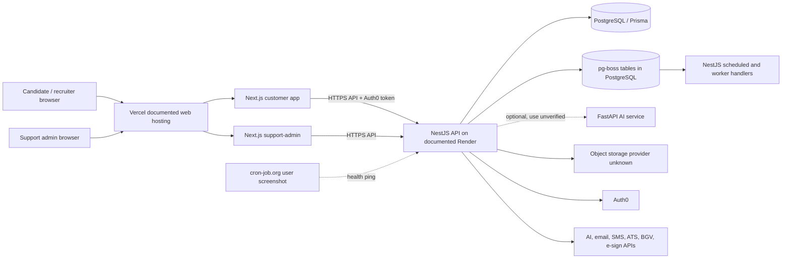
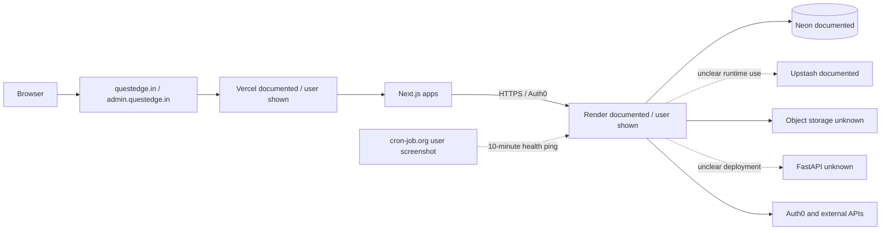

# QuestEdge Complete Architecture Audit and AWS Migration Blueprint

**Assessment date:** 15 November 2026  
**Repository reviewed:** work-nucleus-ai, branch main, commit 8ad1c590a18c2de80a3b486efe7be5daa6e8b4bf  
**AWS region evaluated:** Asia Pacific (Mumbai), ap-south-1  
**Scope:** Read-only source/configuration review and migration planning. No application, deployment, database, or production-system changes were made.

> **Management verdict:** The AWS move is feasible, but the checked-in implementation cannot yet be certified launch-ready. The most serious code finding is a local execution fallback for submitted coding-assessment code. Other material issues include production mock/fallback outputs, tenant isolation that depends on each service query, no checked-in Prisma migration history, and S3 credentials/config that can defeat ECS task-role auth. These require resolution before exposing affected features or migrating production data.

**Evidence terms:** Verified = seen in repository; Documented = stated in repo docs, not checked against live console; User-provided = prior screenshot/message; Inferred = plausible but not confirmed; Unknown = requires provider/production access.

## 1. Executive summary

QuestEdge is a multi-tenant recruiting/referral platform with two Next.js web apps, a NestJS API, a FastAPI AI app, PostgreSQL/Prisma, and a PostgreSQL-backed pg-boss queue/scheduler. The source includes recruiting, referrals, assessments, HR, support, marketplace, audit, background-check and e-sign integration modules. A module or page in source does not prove a live integration or end-to-end production feature.

Repository documentation describes Vercel web apps, Render API, Neon PostgreSQL and Upstash Redis. User screenshots showed questedge.in, admin.questedge.in and cron-job.org configured to ping a Render health URL every ten minutes. Provider dashboards were not accessed. Current plans, regions, secrets, database/files size, backup policy, S3 provider/bucket permissions, DNS, TLS and current cron execution remain unknown.

### Launch-impact findings

| Priority | Finding | Evidence and consequence |
|---|---|---|
| **P0** | Coding-assessment fallback executes submitted code in local Node/Python child processes. | backend/src/modules/assessment-engine/coding/coding.service.ts. Timeout/output limits do not sandbox code; it can access API-process filesystem/network/identity. Disable or isolate before public exposure. |
| **P1** | AI, email/messaging and integration paths have mock/success-shaped fallbacks; some AI results are persisted. | Missing credentials/provider errors can produce fabricated scores/summaries/content or false delivery/verification outcomes. Replace with explicit unavailable/error state. |
| **P1** | Production Compose is not a verified production topology. | infra/docker-compose.prod.yml has env-name mismatches, local MinIO defaults without a matching service, and Redis despite no verified essential active Redis path. |
| **P1** | No checked-in Prisma migration history; deployment docs recommend db push. | Not a controlled/reversible production schema process for a 74-model database. Baseline and rehearse migrations. |
| **P1** | S3 service has explicit credential fallbacks and bucket-creation behavior. | Can prevent AWS SDK task-role credentials from being used; application should not create buckets at startup. Health checks config presence, not an actual object operation. |
| **P1** | Tenant isolation is not globally enforced by the inspected guardrail. | TenantSafetyNet in Prisma service detects selected missing filters but does not add organization scope to each query. |
| **P1** | FastAPI AI service readiness/use is uncertain. | Gemini config required at import; development default internal key; health references undefined settings attribute; backend URL configured but no call via it found. |
| **P2** | CI does not validate every runtime/release path. | No Python job, support-admin production build, backend image build, migration rehearsal, image scan, AWS deploy, or post-deploy smoke check. |
| **P2** | Framework/container maintenance. | Both apps use Next.js 14.2.35; Next.js support policy lists v14 unsupported. Support-admin combines Next 14/React 19 with legacy peer install. Node images run as root by default. |
### Recommendation

Resolve code blockers first, then establish AWS staging and move in parallel. Target ECS Fargate for web/API/worker containers, private RDS PostgreSQL, private S3, CloudFront selectively, ECR, CloudWatch, and GitHub Actions OIDC. Retain Auth0 and external AI/email/SMS/ATS/BGV/e-sign providers unless measured cost or reliability supports a change. Deploy FastAPI only after proving it is used and fixing its readiness defects.

A single EC2/Lightsail host is the low-cost path but a single failure domain. For production reliability, use app tasks across AZs and Multi-AZ RDS. Migration is not zero-code-change: S3 auth/config, mock behavior, worker lifecycle, health/proxy behavior and migration controls need engineering. Plan multiple engineering weeks including fixes, data/file rehearsals and a soak window. A 3–4 day estimate is unsupported by current evidence.

## 2. Repository structure and deployment evidence

### 2.1 Runtime applications

- work-nucleus/frontend — customer Next.js application.
- work-nucleus/support-admin — support/admin Next.js application.
- work-nucleus/backend — NestJS API, Prisma schema and background handlers.
- work-nucleus/ai-service — FastAPI/agent application.
- work-nucleus/infra — Docker Compose/local infrastructure.
- work-nucleus/docs — deployment/product docs.
- .github/workflows/ci.yml — GitHub Actions CI.

Other root directories contain design/planning material, not separate runtime services.

### 2.2 Verified CI and config facts

CI installs deps, generates Prisma client, checks/tests backend, checks/builds frontend, and type-checks support-admin. It omits Python validation, support-admin production build, backend production image, DB migration checks, security/image scans, AWS deployment and post-deploy verification. Vercel config exists for frontend; admin config is minimal. No AWS IaC/workflow or Render manifest was found in reviewed files.

Dockerfiles exist for Node apps and Python. Node images default to root unless overridden; web images copy full dependencies. Dev Compose contains Postgres, Redis and MinIO. Prod Compose is not authoritative: Auth env names differ from backend requirements, Python values do not match Gemini implementation, MinIO defaults have no paired MinIO service, and Redis is included without confirmed active necessity. DEPLOYMENT.md describes Vercel/Render/Neon/Upstash and says Redis is required, conflicting with in-memory cache and pg-boss/Postgres.

## 3. Verified architecture

### 3.1 Topology

AI_SERVICE_URL is configured but no backend call via that URL was found in reviewed call paths; Nest services appear to call Gemini directly. FastAPI deployment/use remains unknown.

### 3.2 Service-by-service assessment

| Service | Purpose/stack and communication | Deployment/resource needs | Failure/security impact |
|---|---|---|---|
| Customer frontend | Next.js 14/React 18; browser → Nest API; Auth0. Recruiting/referral/candidate/employer flows. | Vercel documented/user-shown; build/runtime env, API origin, domains, callbacks and cache need console review. Node container is possible. | Customer workflows stop. Keep secrets server-side and do not cache authenticated responses. |
| Support admin | Next.js 14.2.35/React 19; privileged support/admin API. Fixture data remains, production mock gate exists. | Vercel documented; actual project settings unknown. Require production build, MFA and restricted admin identity. | Admin unavailable; compromise exposes cross-org data/actions. |
| NestJS API | Node 20, NestJS 10, Prisma 6.19; ~50 feature modules. Postgres, pg-boss and external APIs. | Render documented, exact service plan/region/health/scaling unknown. Long-lived process. Container defaults to root. | Core product outage. Risks: local code execution, fake fallback data, tenant scoping, per-process throttle. || FastAPI AI | Python 3.12/FastAPI, Gemini-oriented agents, SQLAlchemy async logs. | Container exists; deployment/call path unknown. Gemini required at import; Compose provider mismatch; health references undefined setting. | No impact if unused; otherwise AI outage. Prompt/output logs need redaction and retention. |
| PostgreSQL | Prisma relational store; 74 models, 64 enums; pg-boss shares DB. | Neon documented only. Version/region/size/extensions/backup/replication unknown. No migration directory. | Critical auth/business/job data dependency. Restore and migration rehearsal mandatory. |
| pg-boss | PostgreSQL-backed jobs/scheduler within Nest backend, not Redis. | Long-lived worker. If API replicas register schedules, prove lock/dedup behavior and idempotency. | BGV, ATS, matching, scoring, expiry and e-sign jobs stall/duplicate. |
| Redis | Docs/dependencies/Compose show Redis/Upstash. Active cache reports in-memory; no essential Redis runtime path identified. | Do not pay/migrate until call paths prove use. In-memory state is per process and resets on restart. | If unused, outage should not affect core functionality; verify all paths before removal. |
| Object storage | Resume/document upload; separate offer S3 client; DB stores object refs; API signs URLs. | User says resume storage configured, but provider/bucket/policy and actual operations unverified. Offer client has separate bucket/MinIO defaults. | Upload/review fails. Static credential fallback, bucket auto-creation and authorization are risks. |
| External APIs | Auth0, Gemini/Anthropic refs, SendGrid/Resend, Twilio/MSG91, ATS, Judge0/RapidAPI, BGV/e-sign. | Live credentials, plans, sandbox/live mode and rate limits unknown; some stubs/adapters. | Provider-specific outage; false success from fallback damages data/user trust. |

### 3.3 Authentication and tenancy

Auth0 JWT validation checks issuer/audience/JWKS in Nest. Admin promotion uses trusted claims/allowlists in the reviewed implementation; tenant configuration, MFA, callbacks, logout URLs, audience and allowed origins are unknown. RBAC guards exist. Support admins have cross-organization privilege.

TenantSafetyNet in backend/src/prisma/prisma.service.ts detects selected undefined org filters but does not inject tenant scope globally. Review every tenant-owned route/query/job/export/file key; test cross-tenant denial with two organizations, including signed resume URLs, search, admin actions and webhook updates.

### 3.4 Database, queue and schedule inventory

Prisma schema: 74 models, 64 enums, PostgreSQL. No checked-in Prisma migrations. DEPLOYMENT.md recommends db push in production; this is not an adequate reviewed rollback/migration procedure.

pg-boss schedules observed: BGV every 5m; ATS sync every 6h; remote sync every 12h; aggregators daily ~06:00; expiry daily ~03:00; URL verification every 30m; matching every 6h; resume scoring daily ~02:00; hire detection ~03:00; hire confirmation weekly Monday; candidate check-in on 1st/15th; trust recalculation weekly Sunday; e-sign poll every 30m. Confirm timezone, retry/retention, dead-letter/replay, idempotency and scheduler locking. Separate web API and worker ECS services are desirable, but worker entrypoint and schedule behavior need verification.

### 3.5 Storage and external operations

Upload service applies type/size/signature checks and uses expiring signed links. Offer rendering has another S3 client/bucket setting with local MinIO defaults. Upload service contains explicit fallback credentials and may try CreateBucket after HeadBucket errors. ECS should use task-role credentials; pre-create buckets and grant object-only actions. Health “configured” status does not prove upload/download.

AI paths can return/persist mock scores, summaries or job description content when keys are missing/provider calls fail. Email/Twilio paths can log mock delivery and return. Replace these with explicit unavailable/failed state. Greenhouse, Lever, Ashby, RemoteOK, Remotive, Jobicy, Careerjet and JSearch connectors are in source; flags and credentials determine operation. Auth0, Digio/AuthBridge/MSG91 and other webhook handlers exist. OnGrid/IDfy/Leegality have stub/incomplete paths. Confirm each live provider flow.
External costs remain after AWS: Auth0, model tokens, email, SMS/WhatsApp, ATS/RapidAPI/Judge0, BGV, e-sign, domains and monitoring.

### 3.6 Documentation mismatches

| Docs/config | Source evidence | Assessment |
|---|---|---|
| Redis required | Active cache in-memory, pg-boss/Postgres | Docs may be stale; verify full call graph. |
| Prod Compose is ready | Auth/Python env mismatches; MinIO assumptions | Not a verified deployable topology. |
| Production db push | No migrations for broad schema | Establish reviewed migration baseline. |
| FastAPI is a production dependency | URL configured but call not found; health/config defects | Actual deployment/use unknown. |
| Storage configured means healthy | Checks env presence | No real storage operation is verified. |
| No mocks | Admin fixtures remain; backend fallbacks remain | Admin gate does not remove backend mock behavior. |

## 4. Current deployment: verified vs unknown

| Item | Status | Dashboard facts still needed |
|---|---|---|
| Vercel apps | Documented/user screenshots | Plans, project branches, build settings, regions, caching/env and recent deploys. |
| Render API | Documented/user screenshot | Plan, region, health checks, scaling, env/deploy settings and uptime. |
| FastAPI | Unknown | Deployed? Which caller/version/secrets/traffic? |
| Neon | Documented only | Version, region, size, extensions, PITR, backups, CDC support, limits. |
| Upstash | Documented only | Runtime use, region, plan, persistence and usage. |
| Object storage | User says configured | Provider, bucket, region, permissions, encryption, retention, inventory. |
| Domain/TLS | User screenshot shows domains | DNS authority/records/TTL/cert settings unknown. |
| Auth0 | Source integration verified | Tenant, MFA, callback/logout URLs, audience, webhooks and plan unknown. |
| cron-job.org | User screenshot showed 10-minute ping | Current enabled state/history not independently checked; keep-alive is distinct from pg-boss. |
| Secrets | Not inspected | Values intentionally not opened or exposed. |
| CI/CD | CI source verified | Provider-side automatic deployment not proven. |

No live dashboards, database or production system were accessed; current runtime health cannot be certified here.

## 5. AWS alternatives and recommendation

### A. Minimum cash cost: one EC2/Lightsail Compose host

All apps and worker on one host, S3 for files. Self-hosting Postgres on that host couples database and apps in one failure domain. Safer constrained variant is managed RDS Single-AZ, but app host remains a SPOF. Official Lightsail list currently has $44/month Linux/IPv4 8 GiB, 2 vCPU, 160 GB SSD, 5 TB transfer; and $84/month 16 GiB. Transfer allowance may vary by region. This is not total stack cost and 8 GiB adequacy must be benchmarked.

Use for staging/pilot or explicitly accepted downtime, not as highly available production. If chosen temporarily, use off-host backups and tested restore/failover runbooks.

### B. Balanced production: ECS Fargate + RDS — recommended

Public ALB across two AZs; ECS app tasks and RDS in private subnets; ECS services for customer app, admin, Nest API and one worker; include Python only after proving use and fixing readiness. Private S3 with task-role access; CloudFront for web/static, not private resumes or authenticated API by default. ECR, CloudWatch, GitHub OIDC, SSM for ordinary config and Secrets Manager if rotation/lifecycle requires it. Multi-AZ RDS where approved RTO requires failover; automated backups/PITR plus restore drills.

Private tasks need egress to external APIs. NAT hourly and GB charges are meaningful. One NAT lowers cost but creates zonal egress failure; one per AZ improves resilience. Public-subnet tasks restricted by SG to ALB can avoid NAT but need explicit egress/security review. Decide based on provider allowlists and threat model.
### C. Scaled/high availability

Two or more API/web tasks across AZs, worker pools/autoscaling, Multi-AZ RDS or Aurora only after benchmarking, robust egress, centralized monitoring and separated prod/staging accounts. WAF, multiple NATs, read replicas, RDS Proxy and Aurora add costs/complexity; use only when measured requirements justify.

| Service | Decision |
|---|---|
| ECS Fargate | Best container fit without host management. |
| ECS on EC2 | Consider for steady utilization if team accepts AMI/capacity/patching operations. |
| EC2 Compose / Lightsail | Cheapest pilot/staging; single host failure domain. |
| App Runner | Not first choice for multiple web/API/worker processes and controlled egress; price/network fit needs more review. |
| RDS PostgreSQL | Recommended managed DB; Single-AZ vs Multi-AZ by approved RTO/RPO. |
| Aurora PostgreSQL | Defer until benchmarks justify cost/scale. |
| S3 | Recommended private document store, with task-role/config changes. |
| CloudFront | Selective static/web distribution; avoid unsafe caching. |
| Route 53 | Optional; DNS provider can remain external. |
| ACM | Public TLS for integrated services; CloudFront cert in us-east-1. |
| ALB | Needed for multi-service ECS routing/TLS/health; hourly + LCU. |
| NAT Gateway | Conditional, price idle/hourly/per-GB cost. |
| Parameter Store / Secrets Manager | Choose one strategy; avoid duplicate secret systems. |
| CloudWatch / ECR | Baseline logs/metrics and private images; define retention/lifecycle. |
| AWS Backup | Optional centralized governance; RDS PITR/snapshot + restore tests baseline. |
| SES | Keep current email provider during host migration unless justified. |

## 6. AWS cost analysis

### 6.1 Pricing date and assumptions

Official pages checked 15 November 2026. RBI rate ₹94.1997/USD at 1 pm on 13 November 2026; INR conversions are rounded. No actual user traffic, DB size, document volume, egress, logs, provider bill or retention was available. All estimates are **planning ranges, not quotes**; recalculate exact Mumbai SKUs in AWS Pricing Calculator.

Verified price anchors: Lightsail public IPv4 Linux bundles list $44/mo for 8 GiB and $84/mo for 16 GiB. AWS public IPv4 is $0.005/address-hour (~$3.65 over 730h). NAT charges hourly and per GB; published AWS example uses $0.045/hour and $0.045/GB in its example region, not a Mumbai quote. RDS, Fargate, ALB, S3, CloudFront, CloudWatch, ECR, Route 53, secrets and backups all bill separate dimensions.

### 6.2 Planning workload tiers

These do not assert current QuestEdge traffic.

| Tier | Planning assumption |
|---|---|
| Early: 100–500 users | Low concurrency, small services/worker, modest DB/files, <0.5–1 TB/mo public egress, AI inference external. |
| Growing: 1,000–5,000 | More API/workers, larger DB, around 1–3 TB/mo egress and more logs/files. |
| Scaling: 10,000+ | Multiple tasks/workers and larger DB/storage/egress; file/AI-heavy use may exceed ranges. |

### 6.3 Estimated monthly totals

USD / INR. Tax, engineering, AWS support, migration one-time costs and external providers excluded.

| Option | Early | Growing | Scaling | Tradeoff |
|---|---:|---:|---:|---|
| A. Single VM/Compose + S3; self-managed or Single-AZ DB | $135–410 / ₹12,700–38,600 | $270–800 / ₹25,400–75,400 | $650–2,100 / ₹61,200–1,97,800 | Lowest cash floor; single host and/or DB failure domain. |
| B. ECS Fargate + ALB + RDS Multi-AZ profile | $480–1,410 / ₹45,200–1,32,800 | $1,030–2,920 / ₹97,100–2,75,100 | $2,900–10,400 / ₹2,73,200–9,79,700 | Better fault isolation; higher idle floor. |
| C. Scaled Multi-AZ ECS + larger DB/Aurora if justified | $1,100–2,500 / ₹1,03,600–2,35,500 | $2,500–6,500 / ₹2,35,500–6,12,300 | $7,000–20,000+ / ₹6,59,400–18,84,000+ | More capacity/availability and complexity. |

### 6.4 Component budget ranges

Ranges are for early-to-scaling use, not precise monthly SKU prices and not meant to sum at maximum simultaneously.

| Line item | A single VM | B balanced | C scaled |
|---|---:|---:|---:|
| Compute, containers, EBS | $75–650 | $180–3,500 | $350–6,000 |
| DB, DB storage and backups | $40–600 | $200–3,000 | $400–5,500 |
| ALB, public IPv4, network | $5–300 | $65–800 | $100–1,500 || NAT/egress processing | $0–150 | $40–600 | $100–1,500 |
| S3/requests/lifecycle/backup | $3–200 | $5–700 | $20–1,000 |
| CDN/public transfer | $0–300 | $0–1,500 | $100–3,000 |
| CloudWatch logs/metrics/alarms | $5–150 | $15–600 | $50–1,200 |
| ECR, secrets, DNS, backup tooling | $3–50 | $15–300 | $50–800 |

Hidden costs: NAT hourly and processing, public IPv4, ALB LCU, RDS Multi-AZ/storage/IOPS/snapshots/proxy, S3 request/retrieval/versioning, CloudFront egress, log ingestion/retention/custom metrics, ECR image retention, Secrets Manager/KMS, Route 53 queries, interface endpoints per AZ, cross-AZ transfer, idle staging and support/tax/FX.

External costs remain: Auth0, Gemini/Claude tokens, email, SMS/WhatsApp, ATS/RapidAPI/Judge0, BGV, e-sign, domains and monitoring. Current bills are unknown.

## 7. AWS compatibility and code/config change estimate

| Area | Finding and classification |
|---|---|
| Next frontend/admin | Node containers viable; configure env/domains/cache/Auth0. Next 14 unsupported; upgrade and align React peer versions (dependency/code change). |
| Nest API | Container viable; configure health/readiness, graceful shutdown, non-root, proxy/rate limits and DB pool. |
| FastAPI | Container viable but fix config/health/internal key; deploy only if actual use confirmed (small code/config). |
| PostgreSQL/Prisma | Compatible in principle; migration baseline and restore rehearsal required (material migration work). |
| pg-boss | Postgres queue works conceptually; worker separation/schedule locking/idempotence needs validation and likely deployment changes. |
| Redis | No migration until code/telemetry proves use. |
| S3 | Remove static credential fallback; task role; pre-create buckets; separate upload/offer permissions and test (small/moderate code/config). |
| Auth0 | Keep external; update callbacks/logout/origins/API URL/webhooks (configuration). |
| Integrations | Keep external; set live keys and remove mock/stub production paths (config plus code). |
| Rate limiting | In-memory per-process; shared enforcement needs shared store/edge change if required. |
| DNS/TLS | Configure custom domains/certs and rollback route (configuration). |

## 8. Security and reliability

### Required controls

1. **Coding assessments:** disable/fail closed or move source execution to disposable, hardened sandboxes with no host mounts/credentials, network denied by default, CPU/memory/process limits and hard timeout. Never execute candidate source inside API container.
2. **Mocks:** explicit unavailable/failure states; do not persist fake scores, summaries, job descriptions, notification delivery or verification results.
3. **Tenant boundaries:** review every tenant-owned route/query/job/export/file; negative cross-tenant tests.
4. **AWS IAM/S3:** narrow task roles and prefixes, Block Public Access, encryption, lifecycle; no app CreateBucket or static fallback credentials.
5. **Secrets:** GitHub OIDC, SSM/Secrets Manager, rotation; no secrets in image/build args/client env.
6. **Network:** public ALB only; RDS private; DB SG only from API/worker; task ingress only ALB; define egress.
7. **Containers:** non-root, minimal/pinned image, scans, no privileged mode, read-only FS where compatible.
8. **Webhooks:** signature/timestamp/replay checks, idempotency, size limits and safe logs.
9. **Monitoring:** alarms for 5xx/latency/task restarts/DB capacity/queue lag/upload errors/backups/billing.
10. **DR:** approved RPO/RTO, off-account backup if warranted, restore drills for database and linked files.

Private tasks need egress to external providers by NAT, controlled public-subnet deployment or proxy/endpoints. A NAT Gateway is not always mandatory; private DB is. One NAT saves cost but is a zonal egress SPOF; two AZ-local NATs improve resilience and cost more. Proposed recovery targets are not guarantees: single-node/Single-AZ may need hours/manual work; Multi-AZ DB plus multiple app tasks can aim for tens of minutes after exercises.

## 9. Phased migration roadmap

Future plan only; not executed. Parallel AWS staging avoids disrupting the current platform.

| Phase | Objective/tasks | Services/cost | Dependencies/risks | Validation/rollback/completion ||---|---|---|---|---|
| **0 Audit/readiness** | Inventory provider plans/regions/env names/DB/files/traffic/callbacks/RPO/RTO/bills. Resolve P0/P1 and establish builds/tests/migration baseline. | No AWS; engineering. | Requires read-only dashboard access; docs may differ from prod. | Reproduce builds, tenant/mock/sandbox/storage tests. Keep live stack untouched. Exit with owner-approved inventory/blocker list. |
| **1 AWS account/IAM** | Prod/stage account choice, MFA/SSO, break-glass, billing, tags/budgets, CloudTrail/KMS and GitHub OIDC. | IAM, CloudTrail, KMS, budgets; low recurring. | Account/payment owner; IAM lockout/overgrant. | Test permitted/denied actions and OIDC. Disable role to roll back. |
| **2 Network/compute** | VPC/AZ/subnets/routes/SG, ALB/ECS/ECR/log groups; choose NAT/endpoints; stage first. | VPC, ECS/Fargate, ALB, ECR, CloudWatch, NAT. | Egress/HA decisions; routing may expose/disable services. | DB subnets private; only ALB ingress; health/budget alarms pass. Delete stage to roll back. |
| **3 DB rehearsal** | Identify source version/extensions/size; backup; restore staging RDS; compare counts/constraints/sequences/indexes; baseline Prisma; test pg-boss. | RDS/snapshots/backup, optional DMS only if CDC supported. | Neon tier replication and downtime unknown; data/schema drift. | Restore from backup, app/migration checks and reconciliation; source remains authority. |
| **4 File copy** | Inventory provider/keys/sizes/owners; private S3; copy preserving keys/metadata; checksums; signed URL and tenant tests. | S3/transfer tooling; storage/request fees. | Provider compatibility and volume unknown; ACL/key mismatch. | Full inventory matches; old store retained for rollback. |
| **5 API/workers** | Immutable image, task role/secrets, staging API + one worker; separate worker if needed; schedules/retry/shutdown tests. | ECS/ECR/RDS/SSM/Secrets/logs/egress. | Code readiness and migrations; duplicate jobs/provider failures. | Auth/CRUD/webhooks/files/jobs pass; task replacement passes. Roll back task definition; source DB unchanged. |
| **6 Web apps** | Build both images; env/API/Auth0/cache; ALB/CloudFront host origins. | ECS/ALB/CloudFront/ACM/ECR. | Next upgrade and Auth0 callback; stale cache/login failures. | Production build/browser/authenticated cache tests; route back to Vercel. |
| **7 Identity/integrations** | Add Auth0 origins/callbacks; domains/certs; webhook destinations/provider allowlists with overlap. | ACM/DNS/provider dashboards. | Provider approvals/retries; old endpoints still receive events. | Login/logout/CORS/signature/replay/sandbox tests; revert callback URLs. |
| **8 E2E validation** | Role/tenant, candidate/company/admin, resumes, AI, connectors, jobs, exports/audit, load/rate, backup/alarms. | Parallel staging AWS. | Safe test data/provider sandbox; avoid real notifications. | Signed validation of security/reconciliation/rollback. No cutover with P0/P1 open. |
| **9 Final sync/cutover** | Freeze source writes/workers; final DB backup/delta; restore; file delta; reconcile; change config and DNS/CDN origin. | RDS/S3/ECS/DNS; temporary double bills. | Downtime and CDC ability; split-brain risk. | Source read-only. Watch errors/queues. Rollback only after reconciling AWS writes; DNS alone cannot undo data. |
| **10 Soak/decommission** | Retain old stack through approved soak; monitor data/jobs/bill; tune; archive backups; cancel only after sign-off. | Both stacks during soak, then AWS. | Early cancellation removes rollback. | Stable window, restore test, no data/object drift, callbacks/jobs work, spend understood. |

### 9.1 Database migration runbook

1. Record engine/version/extensions, table sizes/counts, constraints/indexes/sequences, connections, backup/PITR and logical replication support.
2. Take provider-native backup and consistent pg_dump custom-format backup; record checksum/time securely.
3. Restore into isolated staging RDS and compare counts, aggregates, constraints, sequences and app invariants; run Prisma and pg-boss checks.
4. Reconcile Prisma schema and create reviewed migration baseline as separate implementation work. Do not use production db push.
5. If the source supports rehearsed logical replication, initial load plus CDC may reduce downtime; do not assume the Neon plan supports it.6. Otherwise use short write freeze: pause writes/workers, final backup, restore, reconcile, point app to RDS, start one API/worker then scale.
7. Keep source intact/read-only through soak. Define reconciliation of AWS writes before rollback; DNS rollback alone is not data rollback.
8. Restore a target backup and query it after cutover.

### 9.2 Object migration runbook

Inventory provider, keys, sizes, metadata, owners and DB references. Create encrypted private S3 with Block Public Access, lifecycle and task-role policy. Copy without deleting; compare counts/bytes/checksums; preserve keys; test upload/download/tenant auth/URL expiry; final delta during freeze; retain old store during rollback.

## 10. CI/CD recommendation

PR gates: backend tests/typecheck, Python lint/tests, both Next production builds, Prisma schema/migration check, dependency/image scan. Build immutable image once per commit, tag SHA, push ECR via GitHub OIDC with branch/environment constraints. Automatically deploy main to staging, run reviewed migration as one-off task, then smoke-test Auth0/API/upload/worker. Promote same images to production with environment approval, ECS circuit breaker/blue-green, and backward-compatible expand/contract DB changes. Separate stage/prod databases/buckets/Auth0 clients/secrets. No long-lived AWS keys. Record image SHA/migration/health result and retain prior task definition. Developer PR/merge flow remains normal; release verification is automated.

Current gaps: Python CI, support-admin production build, backend image build, migrations, scans, AWS deploy and post-deploy smoke tests.

## 11. Final recommendation and decision answers

| Question | Assessment |
|---|---|
| AWS architecture? | ECS Fargate, ALB, private RDS, S3, selective CloudFront, ECR/CloudWatch/GitHub OIDC and separate worker; external Auth0/providers. |
| Why versus Render/Vercel? | Unified IAM/network/storage/observability and controlled scaling; not inherently cheaper/easier. Stay on current hosts if they meet needs better. |
| Realistic monthly cost? | Balanced: $480–1,410 (₹45,200–₹1,32,800) early; $1,030–2,920 (₹97,100–₹2,75,100) growing; $2,900–10,400 (₹2,73,200–₹9,79,700) scaling. Excludes external spend/tax. |
| Cheapest safer production? | EC2 app/worker + managed RDS Single-AZ, S3/backups, roughly $135–410/month early planning; app remains SPOF. Same-host DB is cheaper but not advised for resumes/business records. |
| Keep external? | Auth0, model APIs, email/SMS, ATS, BGV/e-sign, current DNS/monitoring until justified. |
| Biggest risks? | Arbitrary code execution, fake outcomes, tenant boundary, DB/files sync, unknown live config, NAT/HA costs. |
| Code changes? | Not zero: S3/task role, fallbacks, worker lifecycle, health/proxy/tests; sandbox and migration baseline could be significant. |
| Timeline? | Multiple engineering weeks including remediation/rehearsals/soak; 3–4 days unsupported. |
| First? | Close P0/P1 and collect live inventory; then staging and DB/file rehearsals. |
| Cancel old providers? | Only after AWS serves domains and data/files/Auth0/webhooks/jobs/restores pass through approved soak and rollback period. |

**Readiness verdict:** Repository evidence cannot certify QuestEdge as launch-ready or AWS-production-ready. Do not expose coding assessments until execution is isolated/disabled; remove fabricated production outputs; prove cross-tenant isolation; establish reversible DB migrations and restore; validate S3 using task roles. This is not a penetration test or live acceptance test.

## 12. Assumptions and unknowns

Obtain owner confirmation for Render/Vercel/Neon/Upstash plans and regions; DB version/size/extensions/backups/PITR/CDC; object provider/inventory; traffic/concurrency/egress/job lag; actual Redis/FastAPI/provider usage; RPO/RTO, maintenance and compliance; Auth0/DNS/TLS/webhook settings; AWS account/credits/tax/support; external monthly bills.

No secret/env-file values were read. No live provider dashboard or production database was accessed. User counts are cost scenarios, not QuestEdge metrics.

## 13. Official references

Pricing checked 15 November 2026; prices change. Use calculator for exact ap-south-1 SKUs.
### Pricing
- [AWS Pricing Calculator](https://calculator.aws/)
- [Lightsail pricing](https://aws.amazon.com/lightsail/pricing/) and [Lightsail bundles](https://docs.aws.amazon.com/lightsail/latest/userguide/amazon-lightsail-bundles.html)
- [EC2 On-Demand](https://aws.amazon.com/ec2/pricing/on-demand/)
- [Fargate](https://aws.amazon.com/fargate/pricing/) and [ECS](https://aws.amazon.com/ecs/pricing/)
- [RDS PostgreSQL](https://aws.amazon.com/rds/postgresql/pricing/)
- [VPC](https://aws.amazon.com/vpc/pricing/) and [NAT pricing guidance](https://docs.aws.amazon.com/vpc/latest/userguide/nat-gateway-pricing.html)
- [Elastic Load Balancing](https://aws.amazon.com/elasticloadbalancing/pricing/)
- [S3](https://aws.amazon.com/s3/pricing/) · [CloudFront](https://aws.amazon.com/cloudfront/pricing/) · [CloudWatch](https://aws.amazon.com/cloudwatch/pricing/) · [ECR](https://aws.amazon.com/ecr/pricing/)
- [Route 53](https://aws.amazon.com/route53/pricing/) · [ACM](https://aws.amazon.com/certificate-manager/pricing/) · [Secrets Manager](https://aws.amazon.com/secrets-manager/pricing/) · [Parameter Store](https://docs.aws.amazon.com/systems-manager/latest/userguide/systems-manager-parameter-store.html)
- [AWS Backup](https://aws.amazon.com/backup/pricing/) · [SES](https://aws.amazon.com/ses/pricing/)

### Implementation
- [Fargate regions](https://docs.aws.amazon.com/AmazonECS/latest/developerguide/AWS_Fargate-Regions.html)
- [DMS PostgreSQL source](https://docs.aws.amazon.com/dms/latest/userguide/CHAP_Source.PostgreSQL.html)
- [ECS deployment circuit breaker](https://docs.aws.amazon.com/AmazonECS/latest/developerguide/deployment-circuit-breaker.html)
- [ECS task IAM roles](https://docs.aws.amazon.com/AmazonECS/latest/developerguide/task-iam-roles.html)
- [GitHub OIDC with AWS](https://docs.aws.amazon.com/IAM/latest/UserGuide/id_roles_providers_create_oidc.html)
- [Next.js support policy](https://nextjs.org/support-policy) and [self-hosting](https://nextjs.org/docs/app/guides/self-hosting)
- [RBI exchange rates](https://www.rbi.org.in/?Id=94): ₹94.1997/USD at 1 pm, 13 November 2026.

---
**Prepared against commit 8ad1c590a18c2de80a3b486efe7be5daa6e8b4bf. This is a planning assessment, not a live cloud audit, price quote, penetration test or production acceptance certification.**
